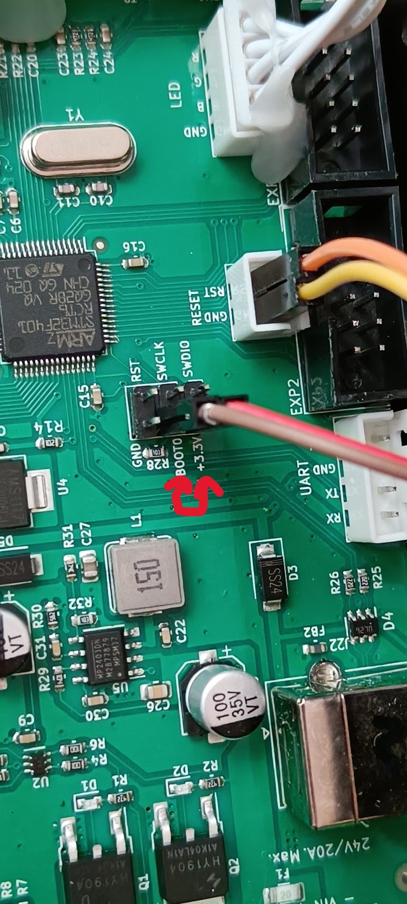
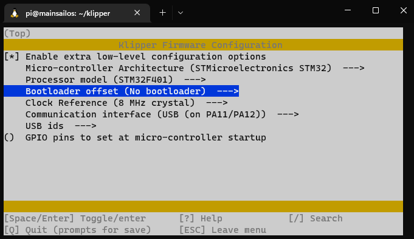

The Sidewinder X2 comes with the [Marlin](https://marlinfw.org/) 2.x firmware, installed on its "Artillery_Ruby" mainboard. This article shows you _one easy_ way to replace Marlin with [Klipper](https://www.klipper3d.org/) as an alternative firmware on your Sidewinder X2.

Be aware that the installed touch display, the USB port, and the SD card slot are unusable with Klipper, because the way they work and are connected is not compatible with it. On my printer, I decided to disconnect them and replace them with dummy prints, but you don't have to.

> **Caution:** Do this only if you feel experienced enough. You do it at your own risk, and you will probably lose the Artillery warranty. I am not responsible for damages of any kind.

> **Update (November 2026):** My Sidewinder X2 `printer.cfg` is part of the official Klipper examples now, the supported Raspberry Pi models and the MainsailOS login changed, and the MainsailOS and Mainsail links point to the current documentation.

## Requirements

- An Artillery Sidewinder X2 with unmodified hardware and an Artillery Ruby V1.2 mainboard
- A Raspberry Pi (Zero 2, 3, or 4; a Pi 5 is supported, too) or a similar compatible board with SD card, power supply, and USB connection to your printer
- A working PC to flash the Pi and to use as a remote SSH console
- The will to open your printer (and the potential loss of warranty)
- Some experience with Linux and the bash console

## Install MainsailOS

- Flash an SD card for your Raspberry Pi with MainsailOS. It's a prepared Raspberry Pi OS Lite with a modern software stack to control your printer. The frontend in this case is [Mainsail](https://docs.mainsail.xyz/) by default. It's similar to [OctoPrint](https://octoprint.org/), but more modern and made for [Klipper](https://www.klipper3d.org/) driven printers only.
- Follow the [official MainsailOS installation guide for the Raspberry Pi](https://docs.mainsail.xyz/mainsailos/getting-started/raspberry-pi/). It uses the Raspberry Pi Imager, where you can also set hostname, user, password, Wi-Fi, and SSH before writing the card. There is also a simple article on [All3DP](https://all3dp.com/2/mainsailos-simply-explained/).
- Klipper needs a `printer.cfg` that tells it all about your connected printer hardware. In Marlin, this configuration lives in _Configuration.h_ and _Configuration_adv.h_ and has to be recompiled on every change. In Klipper, it is just a config file, so you don't have to recompile the whole firmware on changes. There are a lot of example configs in the [Klipper repository](https://github.com/Klipper3d/klipper/tree/master/config).
- For the Sidewinder X2, I created one: [printer-artillery-sidewinder-x2-2022.cfg](https://github.com/Klipper3d/klipper/blob/master/config/printer-artillery-sidewinder-x2-2022.cfg). My Klipper [pull request](https://github.com/Klipper3d/klipper/pull/5810) got merged into the official Klipper examples in October 2022, so you find it there. Copy its content into your `printer.cfg`.
- MainsailOS ships a `mainsail.cfg` with everything Mainsail needs on the Klipper side. Add `[include mainsail.cfg]` to your `printer.cfg`. The documentation page [mainsail.cfg](https://docs.mainsail.xyz/configuration/mainsail-cfg/) explains what it provides.

## Flash Klipper to the printer mainboard

- As mentioned in the caution above, be sure you know what you are doing. I never tried to switch back to Marlin. Normally, it should be no problem, but I have not tried it at the time of writing (comments are welcome).
- You have to bridge two pins to enable the "flash mode" of your mainboard. Open your printer (screws on the bottom). Connect the pins _BOOT0_ and _+3.3V_ with a jumper or a breadboard cable. (You have to remove it after flashing!)

  

- Connect your Raspberry Pi to your Artillery Sidewinder X2 with a USB cable. Then power on your printer and your Raspberry Pi. Connect to the Pi using SSH, or connect a keyboard and monitor to it. Log in with the user and password you set in the Raspberry Pi Imager. The MainsailOS documentation names `pi` and `raspberry` as the defaults, but recommends changing the password.
- Before flashing, you have to configure and build the firmware for your printer once. Open the console of your Pi and type

  ```bash
  cd ~/klipper/
  make menuconfig
  ```

  In the configuration menu, change only the following:

  - Set _Micro-controller Architecture_ to _STMicroelectronics STM32_
  - Set _Processor model_ to _STM32F401_
  - Set _Bootloader offset_ to _No bootloader_
  - Quit (Q) and save (Y)

  

- Build the firmware with

  ```bash
  make
  ```

- Flash the built firmware with

  ```bash
  make flash FLASH_DEVICE=/dev/serial/by-id/usb-Klipper_stm32f401xc_4F006F000351383532393535-if00
  ```

  In your case, the device may have another ID or path. Adapt the command if so. **As mentioned in the caution above, be sure you know what you are doing.**

- Read more details in the official Klipper documentation: [Building and flashing the micro-controller](https://www.klipper3d.org/Installation.html#building-and-flashing-the-micro-controller)
- Remove the _flash mode_ jumper you set above.

## Check and calibrate your setup

Reboot your Raspberry Pi and follow the Mainsail and Klipper configuration checks.

- Follow the [Klipper config checks](https://www.klipper3d.org/Config_checks.html). Ignore OctoPrint, because your setup uses Mainsail instead.
- Make sure some values are adapted and calibrated for your individual printer:
  - Especially the _z-offset_
  - And the extruder rotation_distance (**Measure it without an installed nozzle!**)
- Calibrate the PID values for the heat bed and the extruder nozzle.
- Don't forget to set up or adapt the start and end G-code of your slicer.

## Next steps

These follow-up posts build on this setup:

- A useful set of G-code macros (filament runout, pause and resume, start and stop print): [Must-Have Mainsail, Klipper, and Cura Configuration for the Artillery Sidewinder X2](../2022-10-18-klipper_basic_macros_sidewinder_x2/)
- Re-enabling the stock filament runout sensor: [Re-enable the Filament Runout Sensor of the Artillery Sidewinder X2](../2022-12-23-reenable_sidewinder_x2_runout_sensor/)
- Installing an [ADXL345](https://www.analog.com/en/products/adxl345.html#product-evaluationkit) acceleration sensor and calibrating Klipper [Resonance Compensation](https://www.klipper3d.org/Resonance_Compensation.html): [Install the ADXL345 and Calibrate Input Shaping on the Artillery Sidewinder X2 and Genius Pro](../2023-03-22-install_adxl345_calibrate_inputshaper_sidwinder_x2/)
- Removing and replacing the USB port, the SD card slot, and the useless touch display

## Conclusion

You are done and ready to get in touch with Klipper and its endless possibilities. It takes a while to understand the context. I hope I could help you with the painful start and the initial basic configuration of your Artillery Sidewinder X2.

## Further links

For further steps and more details, it is always a very good idea to walk through the official documentation:

- [Klipper documentation](https://www.klipper3d.org/)
- [Mainsail documentation](https://docs.mainsail.xyz/)
- [Moonraker documentation](https://moonraker.readthedocs.io/)


