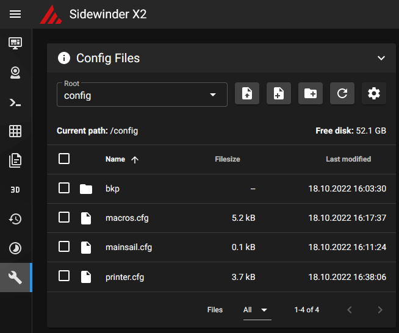
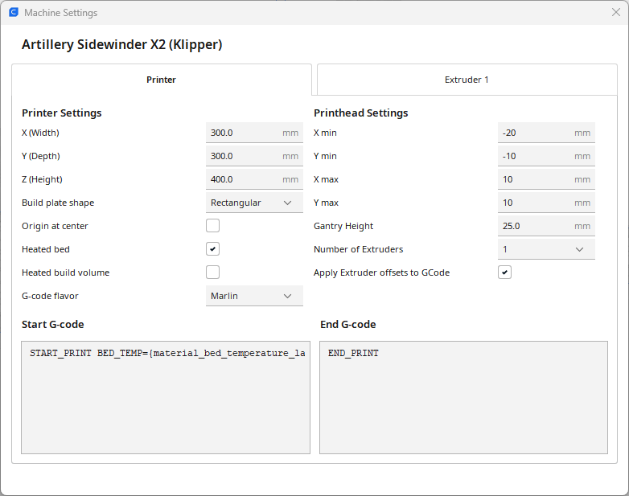

Klipper lets you add G-code macros or even overwrite existing G-codes. By default, Klipper only knows the standard G-codes ([described in the Klipper documentation](https://www.klipper3d.org/G-Codes.html)). You have to configure everything that goes beyond that. Typical scenarios are filament runout, pause and resume print, filament change, and cancel objects. For the Artillery Sidewinder X2, you can also add some macros that define what the Neopixel LED on your extruder should do.

The basic idea is often not mine. Instead, I gathered examples from the documentation and adapted them to the Sidewinder X2 and my needs. My advice is that you start the same way. But you can also just copy mine for your first steps with your Sidewinder.

> **Update (November 2026):** The Sidewinder X2 `printer.cfg` is part of the official Klipper examples, the ADXL345 post exists, and the bundled `mainsail.cfg` is the 2022 state. Today MainsailOS ships `mainsail.cfg` itself, and you customize it with a `_CLIENT_VARIABLE` macro.

## Set up Mainsail and Klipper

For the basic setup of Klipper with Mainsail, you should start by configuring your machine. Set up the printer and Mainsail, and add some basic must-have macros.

1. Log in to the Mainsail web page on your Raspberry Pi, or wherever you run it.
1. Navigate to the config files.
   
1. I suggest splitting your configuration into files according to their content. First add or edit the following three config files.
   1. The [printer.cfg](printer.cfg) contains all configuration of your Sidewinder X2 printer hardware. It also includes a reference to the next two config files.
   1. The [macros.cfg](macros.cfg) contains basic G-code macros to start, end, pause, resume, and cancel the print. In my case, there are also some helper scripts, for example to enable the extruder LED.
   1. And lastly the [mainsail.cfg](mainsail.cfg) (the 2022 state, see [below](#the-mainsailcfg-file)). It configures the basic features in combination with the Mainsail UI, for example to enable the virtual SD card, exclude objects, or pause and resume prints.

### The printer.cfg file

The [printer.cfg](printer.cfg) file represents the printer hardware. In this case, it is the stock Artillery Sidewinder X2, sold in 2022. I already introduced the [printer.cfg](printer.cfg) in my last [blog post](../2022-10-01-klipper_with_artillery_sidewinder_x2/).
I created a [pull request](https://github.com/Klipper3d/klipper/pull/5810) to the official Klipper repository, and it was merged on October 22, 2022. You find the basic printer.cfg example for the Artillery Sidewinder X2 in the [Klipper config examples](https://github.com/Klipper3d/klipper/blob/master/config/printer-artillery-sidewinder-x2-2022.cfg).

In another post, I show you how to add ADXL345 support to enable automatic and precise calibration of the [resonance compensation](https://www.klipper3d.org/Resonance_Compensation.html): [Install the ADXL345 and Calibrate Input Shaping](../2023-03-22-install_adxl345_calibrate_inputshaper_sidwinder_x2/).

See more about the configuration of your hardware in the excellent Klipper [configuration reference](https://www.klipper3d.org/Config_Reference.html).

Don't forget to **calibrate at least your `z_offset`** carefully before printing. If you don't, you could damage your heated bed. See [bed leveling](https://www.klipper3d.org/Bed_Level.html) for more instructions.

### The mainsail.cfg file

The [mainsail.cfg](mainsail.cfg) file represents the minimum configuration for Mainsail. At the time of writing in 2022, I built it from the Mainsail documentation and shipped it as a local file next to the `printer.cfg`. It is the 2022 state, so please treat it as a historical example.

Today, MainsailOS already provides a `mainsail.cfg` from the [mainsail-config repository](https://github.com/mainsail-crew/mainsail-config). It bundles everything Mainsail requires: `[virtual_sdcard]`, `[display_status]`, `[pause_resume]`, and the PAUSE, RESUME, and CANCEL_PRINT macros. You only add `[include mainsail.cfg]` to your `printer.cfg`, as my `printer.cfg` above does, and you don't edit that file. To change its behavior (park position, retraction, and so on), copy the `_CLIENT_VARIABLE` macro into your `printer.cfg` and override only the variables you need. The [Mainsail documentation of mainsail.cfg](https://docs.mainsail.xyz/configuration/mainsail-cfg/) lists all variables.

If you use the current `mainsail.cfg`, you don't need my local copy, and my PAUSE, RESUME, and CANCEL_PRINT macros in [macros.cfg](macros.cfg) may duplicate its macros. In my 2022 setup, I moved the G-code macros to an additional [macros.cfg](macros.cfg) file, and my local `mainsail.cfg` also enables `[exclude_object]` and `[gcode_arcs]`, which the Mainsail documentation does not list for the current file.

### The macros.cfg file

The [macros.cfg](macros.cfg) file contains all our basic G-code macros. That includes the START_PRINT, END_PRINT, PRIME_LINE, PRESENT_PRINT, PAUSE, RESUME, and CANCEL_PRINT macros. In addition, I added some very basic macros to enable, set, and disable the LED under the extruder (ELED_ON, SET_ELED, and ELED_OFF).

### Check the result

If you did everything right, Mainsail shows no errors or warnings on its dashboard. Mainsail is ready to print.

But before printing, make sure you read the [next section](#set-up-the-slicer-cura).

## Set up the slicer (Cura)

I will show you how to set up your Sidewinder X2 using the example of the [UltiMaker Cura slicer](https://ultimaker.com/software/ultimaker-cura/), especially the start and end G-code. Of course, you can adapt this to the other great slicers out there.

If you used Marlin before, you don't have to change the printer and printhead settings. If not, the easiest way for an initial configuration is to add an Artillery Sidewinder X1 as your printer and rename it to X2. It has the same settings.

What's new with Klipper? As you can configure your own G-code macros in Klipper, it's good practice to replace the default Cura start and end G-code scripts with your own G-code macros.
If you use my [macros.cfg](macros.cfg) above, all the start and end logic is defined there.



Just call the [START_PRINT](#start-g-code) and [END_PRINT](#end-g-code) G-code macros in the Start G-code and End G-code sections of your Cura machine settings, as seen in the screenshot above.

For copy and paste:

### Start G-code

```text
START_PRINT BED_TEMP={material_bed_temperature_layer_0} EXTRUDER_TEMP={material_print_temperature_layer_0}
```

It calls the `START_PRINT` macro from [macros.cfg](macros.cfg) with the material print temperatures configured in Cura.

### End G-code

```text
END_PRINT
```

It calls the `END_PRINT` macro from [macros.cfg](macros.cfg).

## Conclusion

If you followed the steps, make sure you calibrated your z_offset and your bed mesh. Then you are ready to print your first object with Klipper.

If you also would like to re-enable the stock filament runout sensor, there is a separate post about that: [Re-enable the Filament Runout Sensor of the Artillery Sidewinder X2](../2022-12-23-reenable_sidewinder_x2_runout_sensor/)

## Further links

For further steps and more details, it is always a very good idea to walk through the official documentation:

- [Klipper documentation](https://www.klipper3d.org/Overview.html)
- [Mainsail documentation](https://docs.mainsail.xyz/)
- [Moonraker documentation](https://moonraker.readthedocs.io/)


