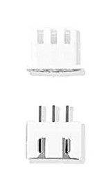
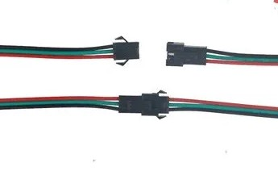
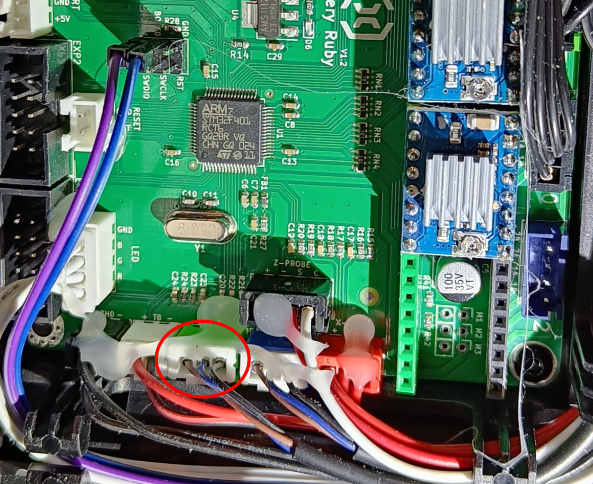
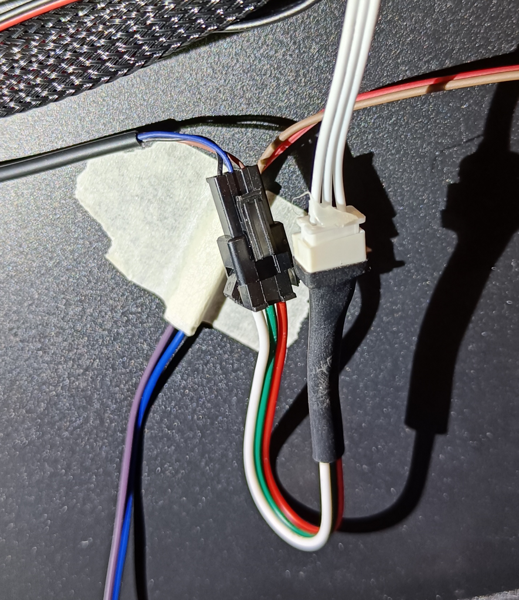
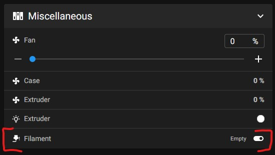

The stock filament runout sensor is connected to the TFT display controller board. This is the reason why neither the Marlin firmware nor Klipper recognizes it by default. For both firmwares, you have to connect the sensor to the Artillery Ruby mainboard instead of the TFT controller board.

In short:

- Connect your filament runout sensor to the z-endstop pins.
- Configure a Klipper filament switch sensor section with the z-endstop pin (PA0).

The long version has a few minor problems to solve:

1. Different voltage (3.3V vs. 5V)
1. Connecting the wires to free pins
1. Configuring Klipper

> **Caution:** Do this only if you feel experienced enough. You do it at your own risk, and you will probably lose the Artillery warranty. I am not responsible for damages of any kind.

## Check the voltage

The pins of the Artillery Ruby mainboard have either 5V or 24V. But the filament runout sensor is connected to the TFT controller at a 3.3V pin.

Sadly, no specs about the runout sensor are in circulation, so nobody knows if 5V would be too much for it. But after some investigation, I found that all similar sensors have a voltage range of 3~5V. So I tried it, and it worked. Of course, it's your own decision and risk.

## Connect the wires

I see two possibilities for connecting the filament runout sensor wires to the correct pins. The fast version works without opening the printer case. A beautiful solution, on the other hand, requires opening the printer case.

### The fast and dirty option

Build yourself an adapter from a male JST-XH 2.54mm connector with three pins to your z-endstop JST SM connector with three pins. The z-endstop plug is fixed on the right side with adhesive tape.

You need these two connector types:

| JST XH 2.54 connector                                                             | JST SM connector                                                    |
| --------------------------------------------------------------------------------- | ------------------------------------------------------------------- |
|  |  |

Or you can just use some jumper cables. These are the pins of the filament runout sensor: 

If the state LED of your filament runout sensor is lit, your connection should be fine.

### The beautiful option

The more beautiful option is to do nothing on the outside of your Sidewinder X2. Instead, open your printer case at the bottom. (As with any other modification, know what you are doing and be aware that your warranty will be lost.)

The original cable comes from the small z-axis board and goes to the TFT controller board. Unplug it from the TFT controller board and plug it into the z-endstop connector of your Artillery Ruby board.  Fix it with hot glue.

There is still one problem. In my case, the original cable was not long enough, so I had to extend it. I did that with the adapter cable from the fast and dirty option above.
 It would be better to replace the original cable with one that is long enough.

Finally, it's time to configure Klipper.

## Configure Klipper

At the end, you have to configure Klipper to use the newly connected filament runout sensor. That's probably the easiest part.

Open your printer.cfg and add the following section

```yml
[filament_switch_sensor filament]
pause_on_runout: True # Starts the PAUSE g-code script if filament runs out
runout_gcode: M117 Filament runout # Optional
insert_gcode: M117 Filament insert # Optional
switch_pin: PA0 # the z-endstop pin
```

and restart the Klipper firmware afterwards.

If you did it right, you will see a new entry in the _Miscellaneous_ section of your Mainsail web UI.  It toggles when you insert or remove filament in your filament runout sensor. Also, the status LED switches between red and green as before.

## Conclusion

By following this post, you not only re-enabled your filament runout sensor, you also enabled it for real for the first time. Even if you are still using the Marlin firmware, you now have the possibility to configure it in your firmware. I still don't know why Artillery didn't just connect it right out of the box. But now it works, and maybe you had some fun fixing the sensor.


