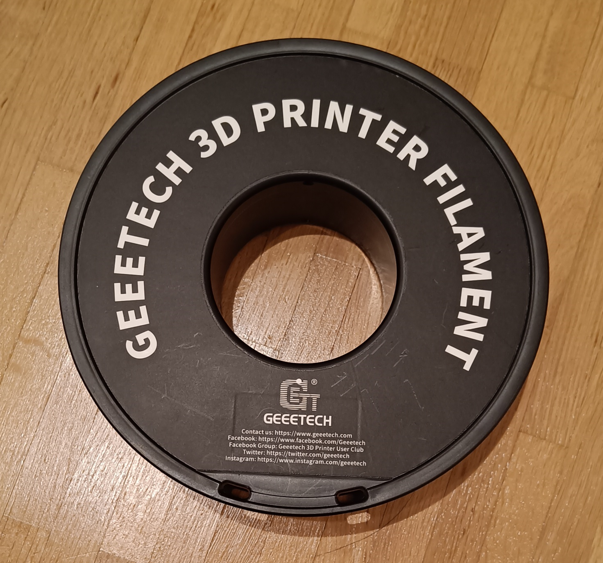
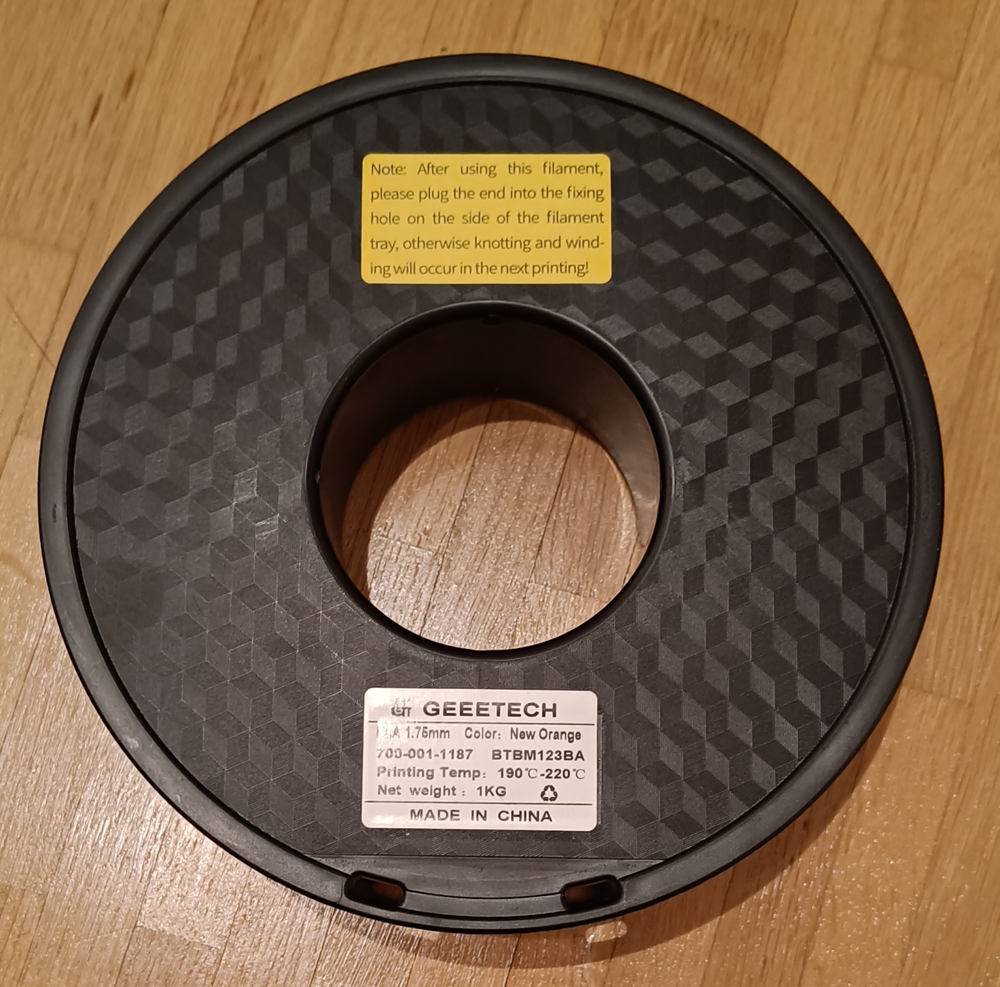
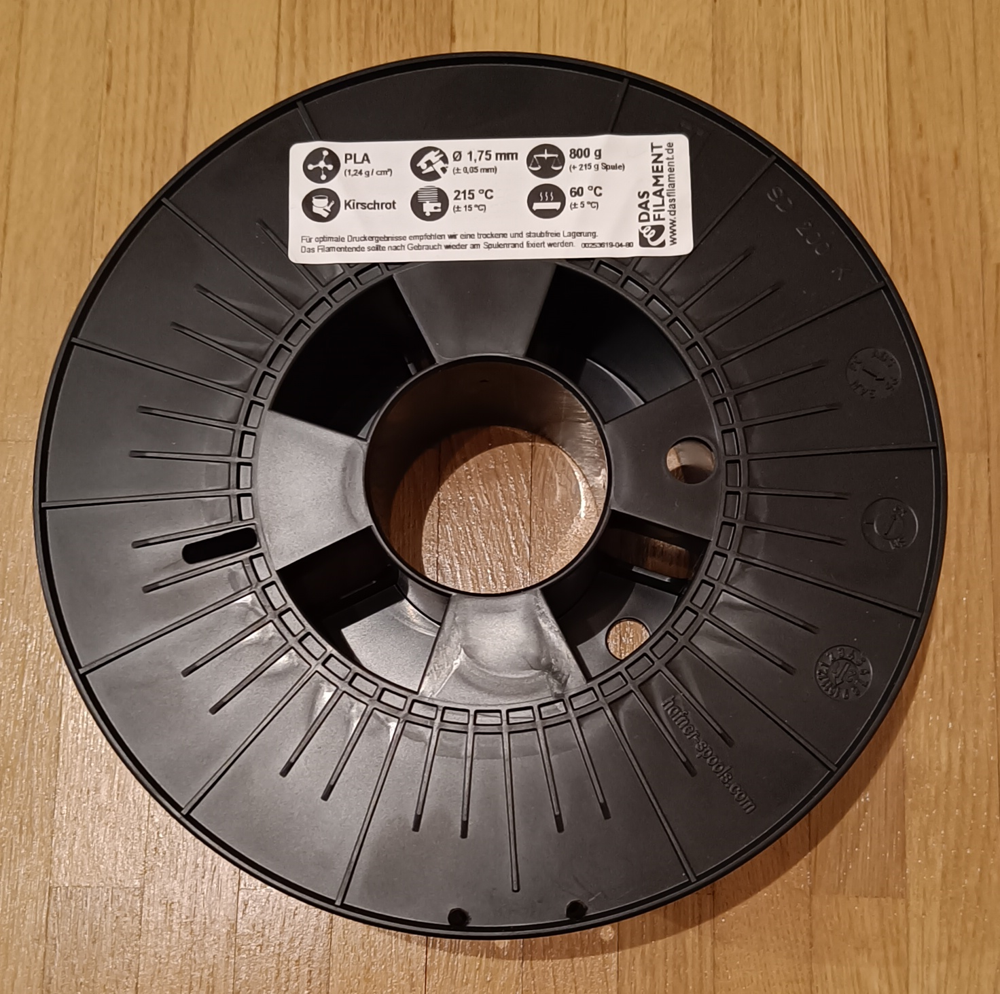
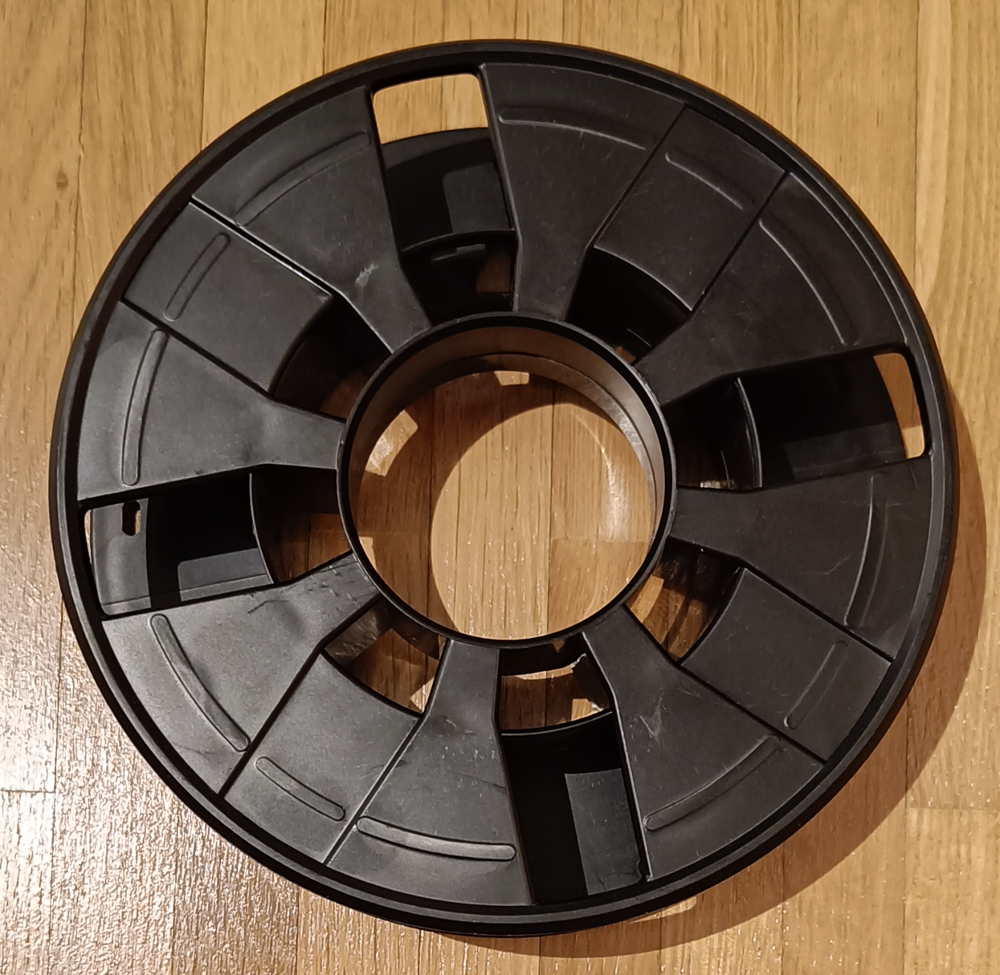
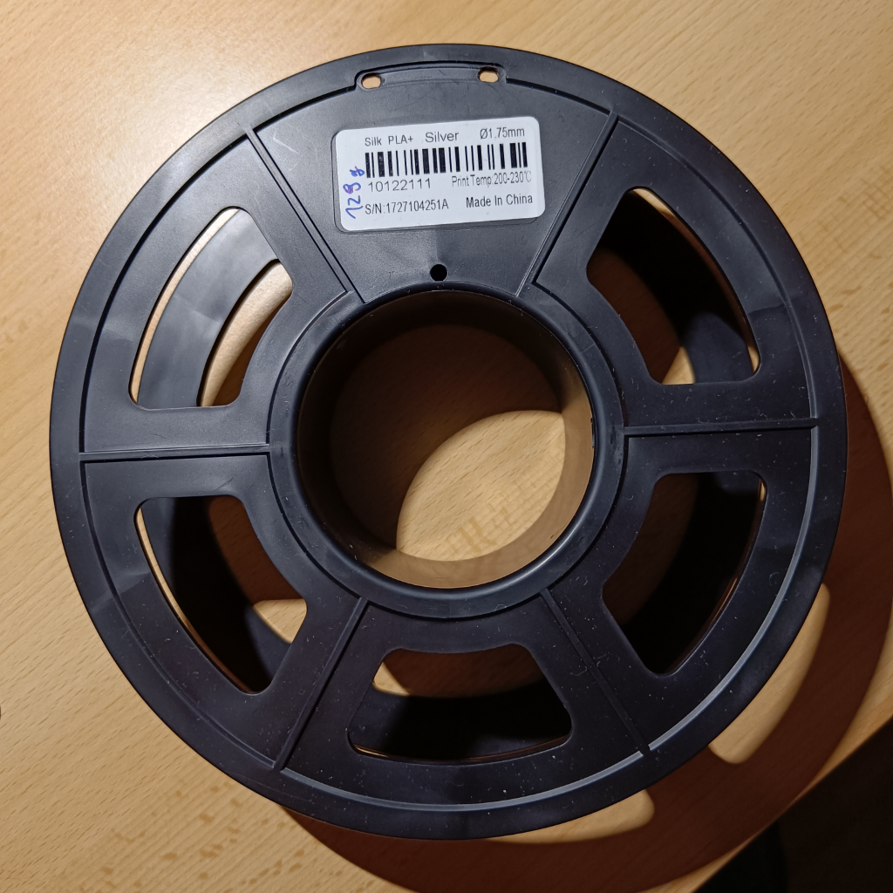

This is my list of relevant information about the different filaments I printed with.

> **Update (November 2026):** I removed the spool weight of the Sunlu ABS, which was wrongly entered as 1000g (the weight of the filament itself), and added the back picture of the Geeetech PLA spool. The correct value is unknown for now ("?").

| Type      | Brand        | Filament weight | Spool weight | Print temperature | Retraction | Flow | Bought | Picture                                                                           |
| --------- | ------------ | --------------- | ------------ | ----------------- | ---------- | ---- | ------ | --------------------------------------------------------------------------------- |
| PLA       | Geeetech     | 1000g           | 182g - 188g  | 210°C             | 0.8mm      | 98%  | 2022   |   |
| PLA       | Das Filament | 1000g           | 214g - 215g  | 210°C             | 0.8mm      | 96%  | 2022   |  |
| PLA+      | iMetrx       | 250g            | 111g - 114g  | 210°C             | 0.8mm      | 96%  | 2022   |             |
| PLA+      | Sunlu        | 1000g           | 126g - 129g  | 210°C             | 0.8mm      | 100% | 2022   |                                                                                   |
| PLA+ Silk | Sunlu        | 1000g           | 126g - 129g  | 210°C             | 0.8mm      | 100% | 2022   |     |
| ABS       | Sunlu        | 1000g           | ?            | 250°C             | 0.5mm      | 98%  | 2022   |                                                                                   |


