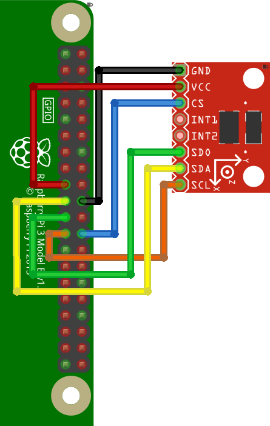
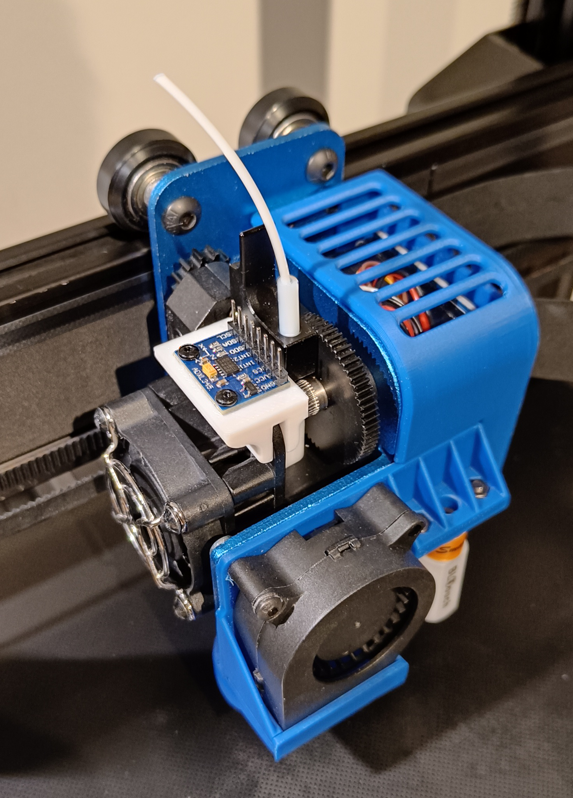
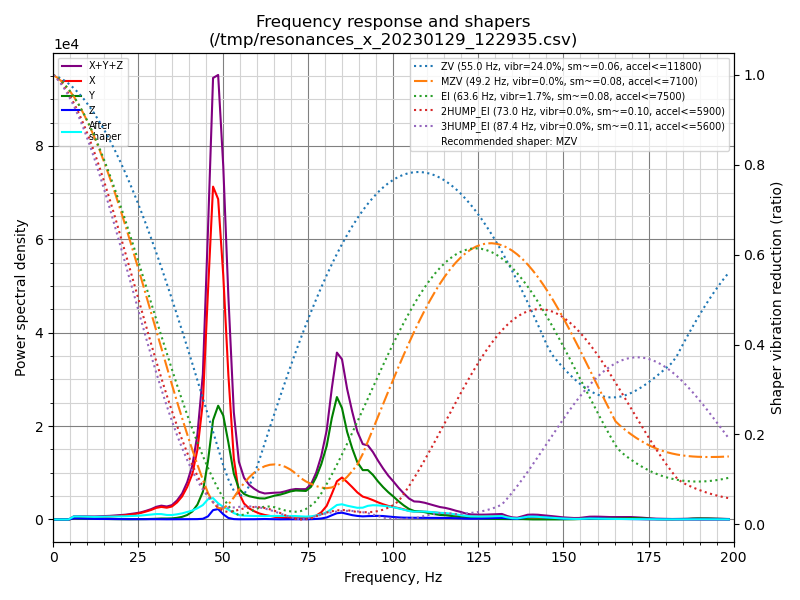
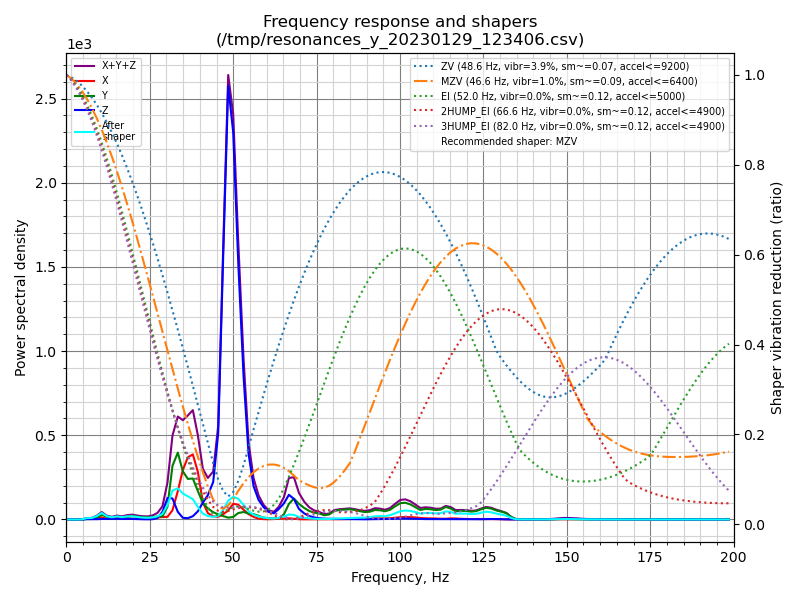

_Input shaping_ (also called _resonance compensation_) is a technique to reduce vibrations and resonances by proactively adjusting the printer movements. It increases the maximum possible printer speed without reducing the print quality. You can find more details in the Klipper [Resonance Compensation](https://www.klipper3d.org/Resonance_Compensation.html#resonance-compensation) documentation.

This article focuses on the Klipper firmware, but Marlin has also had a simpler input shaping since version 2.1.2 (see [M593](https://marlinfw.org/docs/gcode/M593.html)). It supports only the ZV shaper, and Marlin does not provide accelerometer-based tuning: you tune it with a ringing tower or a frequency sweep.

There is also a manual way to determine the resonance frequencies. This post shows you the steps to measure the frequencies with an ADXL345 accelerometer chip instead. You can get one for a few bucks.

Ready? Let's start!

> **Update (November 2026):** The software installation command now follows the current Klipper documentation (`libopenblas-dev`, `numpy<1.26`), and the Marlin remark is corrected: Marlin has simple ZV input shaping since version 2.1.2. The `SHAPER_CALIBRATE` commands are split per axis, and the diagrams of the manual measurement are embedded.

## Requirements

- Your printer (tested with the Artillery Sidewinder X2)
- A working Klipper installation (tested with [MainsailOS](https://docs.mainsail.xyz/))
- Jumper cables or similar
- ADXL345 accelerometer module
- An adapter to mount it on your extruder ([see my design on Thingiverse](https://www.thingiverse.com/thing:5511453))
- Raspberry Pi (or any other connected MCU with an SPI interface)

## Install and wire the accelerometer

As always, Klipper has very clean and useful documentation. It describes well how to [wire the accelerometer](https://www.klipper3d.org/Measuring_Resonances.html#wiring).

Here is an example of how to connect your ADXL345 to the SPI interface of the Raspberry Pi. It is a copy of the relevant wiring diagram:



I used standard jumper cables for that task, but if you want to do some crafting, go ahead.

If you have a Sidewinder X1/X2 or Genius Pro, you can use [my mount from Thingiverse](https://www.thingiverse.com/thing:5511453) to install the accelerometer on your extruder. I suggest V2: the sensor is parallel to the xy-plane and mounted with screws.
Because those printers are bed slingers, the measurement of the resonance frequency should be split. To measure the frequency of the y-axis, you should install the accelerometer on your heated bed. I made an adapter for that too. (Thanks to _Paradisebaker_ for clarifying that.)

If you own another printer, you have to look for a different mounting solution.



## Build a Klipper MCU for the Pi

To make use of the SPI interface, you need to build and set up an additional Klipper firmware for your target. Then you can configure it as an MCU in your config files.

### Install the software

[Detailed Klipper documentation](https://www.klipper3d.org/Measuring_Resonances.html#software-installation)

- Log in to your MainsailOS Pi.
- Make sure the needed packages are installed. (In newer MainsailOS versions, everything is already installed.)

  ```sh
  sudo apt update
  sudo apt install python3-numpy python3-matplotlib libatlas-base-dev libopenblas-dev
  ```

  ```sh
  ~/klippy-env/bin/pip install -v "numpy<1.26"
  ```

### Build the secondary MCU for the Pi

[RPi Micro-Controller documentation](https://www.klipper3d.org/RPi_microcontroller.html)

- First, make sure the Linux SPI driver is enabled by running `sudo raspi-config` and enabling SPI under the "Interfacing options" menu.

- Next, compile the Klipper micro-controller code, start by configuring it for the "Linux process":

  ```sh
  cd ~/klipper/
  make menuconfig
  ```

In the menu, set "Microcontroller Architecture" to "Linux process," then save and exit.

- Build and install the new micro-controller code, run:

  ```sh
  sudo service klipper stop
  make flash
  sudo service klipper start
  ```

- Copy the matching klipper-mcu service, then enable and start it.

  ```sh
  cd ~/klipper/
  sudo cp ./scripts/klipper-mcu.service /etc/systemd/system/
  sudo systemctl enable --now klipper-mcu.service
  ```

- Configure the newly compiled RPi MCU in your `printer.cfg`

  ```yml
  [mcu rpi]
  serial: /tmp/klipper_host_mcu

  [adxl345]
  cs_pin: rpi:None
  axes_map: -y, x, z # Depends on mounting direction. Works for my V2 Mount

  [resonance_tester]
  accel_chip: adxl345
  probe_points:
      150, 150, 20 # mid of your bed (Sidewinder size: 300x300mm)
  ```

## Test the accelerometer

- Open your G-code console (for example in Mainsail).
- Check if the accelerometer responds. If not, double-check the steps above and the Klipper documentation.

  ```text
  ACCELEROMETER_QUERY
  ```

- The output should look similar to this:

  ```text
  accelerometer values (x, y, z): 536.266849, -888.247130, 9918.759623
  ```

- Check that the sensor and wires don't have too much noise:

  ```text
  MEASURE_AXES_NOISE
  ```

- All values should be below 100:

  ```text
  Axes noise for xy-axis accelerometer: 11.789601 (x), 16.017559 (y), 29.190110 (z)
  ```

If you have problems, see [Checking the setup](https://www.klipper3d.org/Measuring_Resonances.html#checking-the-setup)

## Measure resonances manually

- Test the x-axis resonances in the G-code console (for example in Mainsail). _Mount your ADXL345 on your extruder._

  ```sh
  TEST_RESONANCES AXIS=X
  ```

- Log in to your Raspberry Pi terminal (with SSH).
- Run `calibrate_shaper.py` with the generated CSV file. This also generates a nice diagram of the measured and calculated frequencies.

  Example:

  ```sh
  ~/klipper/scripts/calibrate_shaper.py /tmp/resonances_x_*.csv -o ~/printer_data/config/shaper_calibrate_x.png

  Fitted shaper 'zv' frequency = 53.8 Hz (vibrations = 11.0%, smoothing ~= 0.060)
  To avoid too much smoothing with 'zv', suggested max_accel <= 11300 mm/sec^2
  Fitted shaper 'mzv' frequency = 55.0 Hz (vibrations = 0.0%, smoothing ~= 0.067)
  To avoid too much smoothing with 'mzv', suggested max_accel <= 8900 mm/sec^2
  Fitted shaper 'ei' frequency = 69.4 Hz (vibrations = 1.4%, smoothing ~= 0.067)
  To avoid too much smoothing with 'ei', suggested max_accel <= 9000 mm/sec^2
  Fitted shaper '2hump_ei' frequency = 81.8 Hz (vibrations = 0.0%, smoothing ~= 0.081)
  To avoid too much smoothing with '2hump_ei', suggested max_accel <= 7400 mm/sec^2
  Fitted shaper '3hump_ei' frequency = 98.4 Hz (vibrations = 0.0%, smoothing ~= 0.085)
  To avoid too much smoothing with '3hump_ei', suggested max_accel <= 7100 mm/sec^2
  Recommended shaper is mzv @ 55.0 Hz
  ```

  

  The diagram is from another measurement run than the output above, so the values differ a bit.

- Test the y-axis resonances in the G-code console (for example in Mainsail). _Mount your ADXL345 on your heated bed. There is also an adapter on my [Thingiverse page](https://www.thingiverse.com/thing:5511453)._

  ```sh
  TEST_RESONANCES AXIS=Y
  ```

- Log in to your Raspberry Pi terminal (with SSH).
- Run `calibrate_shaper.py` with the generated CSV file. This also generates a nice diagram of the measured and calculated frequencies.

  Example:

  ```sh
  ~/klipper/scripts/calibrate_shaper.py /tmp/resonances_y_*.csv -o ~/printer_data/config/shaper_calibrate_y.png

  Fitted shaper 'zv' frequency = 39.6 Hz (vibrations = 18.1%, smoothing ~= 0.102)
  To avoid too much smoothing with 'zv', suggested max_accel <= 6100 mm/sec^2
  Fitted shaper 'mzv' frequency = 30.8 Hz (vibrations = 1.0%, smoothing ~= 0.215)
  To avoid too much smoothing with 'mzv', suggested max_accel <= 2800 mm/sec^2
  Fitted shaper 'ei' frequency = 41.6 Hz (vibrations = 1.3%, smoothing ~= 0.186)
  To avoid too much smoothing with 'ei', suggested max_accel <= 3200 mm/sec^2
  Fitted shaper '2hump_ei' frequency = 40.2 Hz (vibrations = 0.0%, smoothing ~= 0.334)
  To avoid too much smoothing with '2hump_ei', suggested max_accel <= 1700 mm/sec^2
  Fitted shaper '3hump_ei' frequency = 48.0 Hz (vibrations = 0.5%, smoothing ~= 0.356)
  To avoid too much smoothing with '3hump_ei', suggested max_accel <= 1500 mm/sec^2
  Recommended shaper is ei @ 41.6 Hz
  ```

  

  Again, this diagram is from another measurement run than the output above.

- Configure the _input_shaper_ section in `printer.cfg`. You can take the following snippet and replace the frequencies and algorithm with your calculated and chosen ones.

  Example:

  ```yml
  [input_shaper]
  shaper_freq_x: 55.0
  shaper_type_x: mzv
  shaper_freq_y: 41.6
  shaper_type_y: ei
  ```

## Calibrate automatically (alternative)

If you are not interested in the details, you can use the automatic `SHAPER_CALIBRATE` script. See the [Input Shaper auto-calibration](https://www.klipper3d.org/Measuring_Resonances.html#input-shaper-auto-calibration) documentation.

- In short:

  ```sh
  SHAPER_CALIBRATE
  ```

  or, if you have to move the accelerometer between the axes as on a bed slinger, one axis at a time:

  ```sh
  SHAPER_CALIBRATE AXIS=X
  SHAPER_CALIBRATE AXIS=Y
  ```

- Don't forget to save your config:

  ```sh
  SAVE_CONFIG
  ```

## Conclusion

I hope this was straightforward and you could successfully measure your resonances. Now you should be able to print faster with your Artillery Sidewinder X2. Try to increase your acceleration and speed.

## Further links

For further steps and more details, it is always a very good idea to walk through the official documentation:

- [Klipper documentation](https://www.klipper3d.org/Overview.html)
- [Mainsail documentation](https://docs.mainsail.xyz/)


