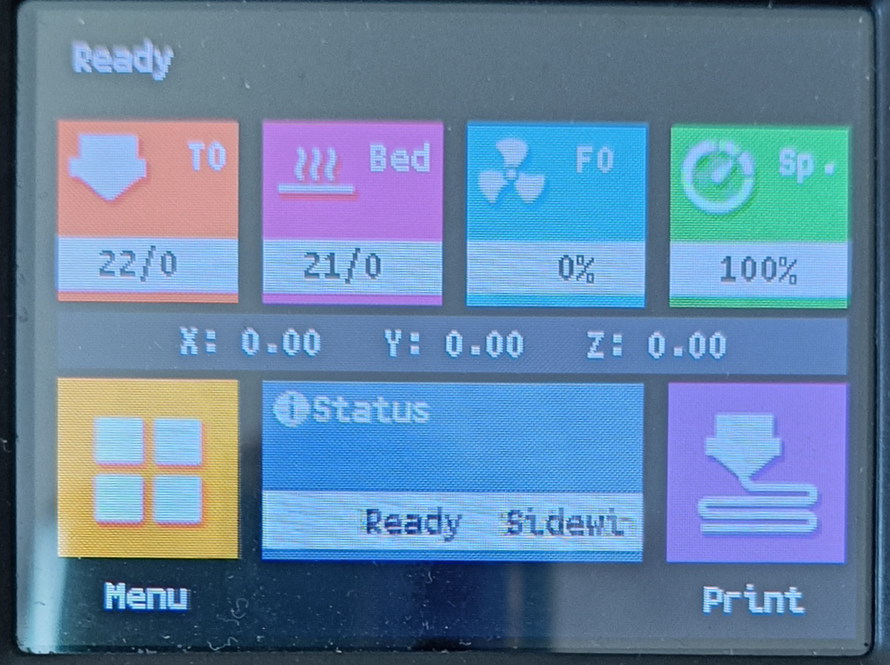
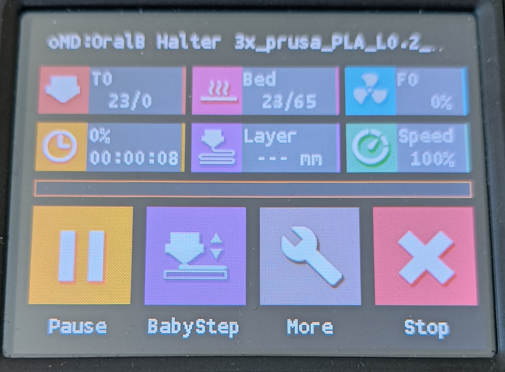
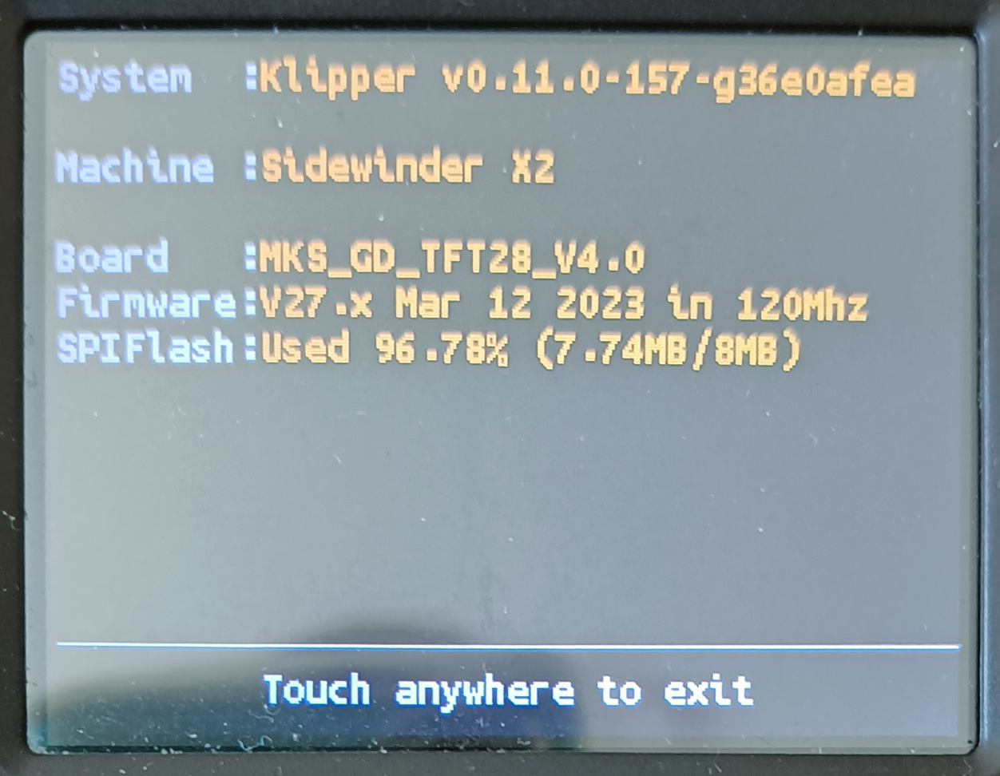
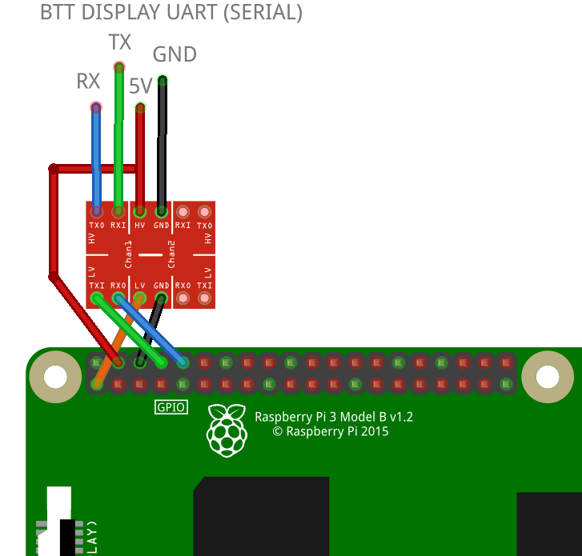
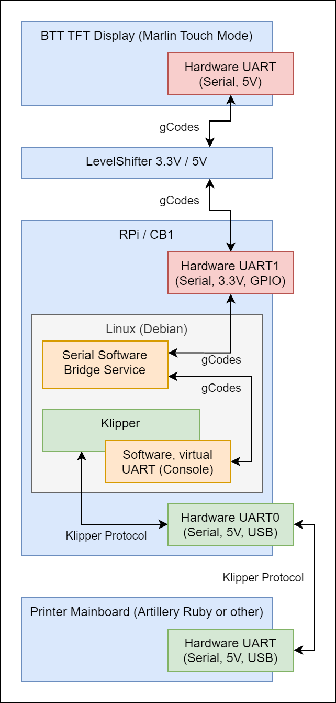

If you have been following my recent posts, you know that I switched from Marlin to Klipper on my Artillery Sidewinder X2. If you have done the same, you may be experiencing the same problem as I did. You have already asked me how much better the printing results are with Klipper, but that is another topic.

**Our integrated display is useless!**

But I found a solution. It is not perfect yet, but more than OK for my main use cases. After reading a lot of discussions, I understood the relationships between the printer mainboard, the included TFT, Marlin, and Klipper, and I got an idea.

So I started an experiment, which I think was successful. It resulted in an open source project, which is an experiment in itself.

So what am I talking about?
I made the integrated display (and potentially any [supported BigTreeTech TFT](https://github.com/bigtreetech/BIGTREETECH-TouchScreenFirmware)) work with Klipper.

  

> **Update (November 2026):** The BigTreeTech issue about the GD32F305 TFT is closed now, and the project has an additional macro file for a status LED. But the official firmware release Vx.x.28 is reported not to flash on the Sidewinder X2 screen, so check the requirements section.

> **Caution:** As always with my other posts and projects, I am not a company. I do this in my spare time, mostly because I am really excited to make these things work and to improve them. I tested all of this only with my own printer and the setup around it. I did my best to make it all work without problems. However, **there is no warranty. Be careful, watch your printer, and double-check things. Use it as it is. I assume no liability for damages or consequences of any kind.**

## Requirements

- A Raspberry Pi or BigTreeTech CB1 (most of you already use one for Klipper)
- A level shifter (a cheap part, [for example](https://www.amazon.de/s?k=levelshifter+3%2C3+zu+5v&sprefix=levelshifter+%2Caps%2C83&ref=nb_sb_ss_ts-doa-p_1_13))
- A BigTreeTech TFT in touch mode (I used the BTT TFT28 with the GD32F305 chipset in my Artillery Sidewinder X2)
  - Most things should work with the official Artillery firmware.
  - To get all the features, flash the open source [TouchScreenFirmware](https://github.com/bigtreetech/BIGTREETECH-TouchScreenFirmware#installation).
  - Support for the GD32F305 TFT controller was requested in [this issue](https://github.com/bigtreetech/BIGTREETECH-TouchScreenFirmware/issues/2391), which was closed as completed in February 2024. The repository contains the Artillery TFT28 V3.0.5 (GD32F305) bootloader, but a user [reports](https://github.com/bigtreetech/BIGTREETECH-TouchScreenFirmware/issues/3029) that the release Vx.x.28 does not flash on a Sidewinder X2 with a GD32F305 TFT28 (modified versions work). I could not verify the current state myself, so check that issue before you flash. Thanks for all the work, guys!

So, let's start hacking and improving your printer.

## Wire the display

First, you need to wire things up. Disconnect the display from your mainboard. It needs to be connected to your Raspberry Pi instead.

I made a little schematic that shows how to connect your Pi through a level shifter to the UART (serial) interface of your BTT TFT (or a compatible one, like the one in the Artillery Sidewinder X2).
It is really important to use a level shifter here. If the UART pins of your Raspberry Pi GPIO get 5V, they will be irreparably damaged and burn. **Be careful!**

That is not a mistake: make sure that somewhere between the display UART and the Raspberry Pi UART you have a TX (transmit) and RX (receive) crossover. It allows a bidirectional connection between them.

That is all the hardware magic you need.

## Set up the software

The hardware wiring is only part of the story. The following schematic shows the relevant components, their connections, and the type of data transferred. I hope it helps you understand the concept.

You can find my project at [https://github.com/freakydude/klipper-serial-btt](https://github.com/freakydude/klipper-serial-btt).

### Set up the serial software bridge with a systemd service

Prepare your Raspberry Pi or BigTreeTech CB1 (or similar) as [described in the project readme](https://github.com/freakydude/klipper-serial-btt#prepare-your-raspberry-pi--btt-cb1).

### Set up Klipper (with Mainsail)

As you can see in the schematic above, your touchscreen and the BigTreeTech firmware running on it are based on G-code. Basically, it sends and receives Marlin-compatible G-code upon interaction. Therefore, for Klipper to communicate with the display in a useful way, we need to provide the necessary G-code macros for Klipper.

Prepare your Klipper and Mainsail configs as [described in the project readme](https://github.com/freakydude/klipper-serial-btt#prepare-klippermainsail).

To keep the overview, I have split the macros into several files: the example file below, and four files in the `fd-macros` folder of the project.

#### fd-macros-example.cfg

For full Mainsail feature support, you must add some macros. Mainsail even has a self-updating repository of what you can add to your Klipper and Mainsail configuration. To enable some functions on your TFT, some of these macros need to be changed. But due to technical limitations, I don't know a way to override G-code commands twice (which is what we would have to do).

This has consequences:

- At the moment I don't know a way to extend or replace their macros, but I need to. So I reimplemented the needed functionality. This makes me kind of sad. It also means you can't use their config files, because they conflict with my scripts.
- I made this file, and if you look at it, it mostly just calls "internal" macros starting with `_FD_`. This way I'm trying to give you the ability to "override" my individual scripts with whatever you want, and hopefully not get into conflicts.

So if you have an Artillery Sidewinder X2 and just want to get started, use this file as it is and feel freakyDude's printing style ;-).

If you need or want to have your own scripts, don't include this file. Instead, copy it completely, include your copy, still call the internal macros, and adapt it to your needs. It is kind of a front for the other macros.

#### fd-macros/klipper-modules.cfg

This file activates all the modules needed to support all the features required by both Mainsail and the BTT touchscreen. If you have already configured some of the modules, you can delete them from your other config files.

#### fd-macros/mainsail-support.cfg

This file contains all the "internal" macros to support the current Mainsail features required by both Mainsail and the BTT touchscreen. I would not suggest replacing them. Use them as they are.

If there are problems with it, let's discuss the issue and create a pull request.

#### fd-macros/bigtreetech-support.cfg

Similar to `mainsail-support.cfg`, this file contains all the "internal" macros to support the current BTT touchscreen features. Mostly, this is a subset of the Marlin G-codes. It also sends some information to the display, so it communicates in both directions. I only implemented what I needed and tested the features, and some things don't fit between Klipper and Marlin. I think it is a good start.

As with the file above, use the macros as they are. If there are problems with them, let's discuss the issue and create a pull request.

#### fd-macros/status-led-support.cfg

This file visualizes some printer states with a Neopixel or Dotstar LED, for example the extruder LED of the Sidewinder X2. It is optional, and it is ignored unless your `printer.cfg` has a `[neopixel statusled]` or `[dotstar statusled]` section. The [project readme](https://github.com/freakydude/klipper-serial-btt#optional-support-of-a-status-led) has an example section for the Sidewinder X2.

### Set up your slicer

To enable the progress and color change features, configure your slicer as [described in the project readme](https://github.com/freakydude/klipper-serial-btt#prepare-your-slicer).

## Conclusion

If you have successfully followed my instructions, you may be one of the first people on the planet to have this combination: a BTT touchscreen in Marlin touch mode, working on a printer driven by Klipper. And yes, since we are all green these days, you did not throw away your working hardware. Congratulations!

For further steps and more details, it is always a good idea to go through the very good official documentation.

## Further links

- [klipper-serial-btt (this project)](https://github.com/freakydude/klipper-serial-btt/tree/main)
- [Klipper documentation](https://www.klipper3d.org/Overview.html)
- [Mainsail documentation](https://docs.mainsail.xyz/)
- [BIGTREETECH-TouchScreenFirmware](https://github.com/bigtreetech/BIGTREETECH-TouchScreenFirmware)


