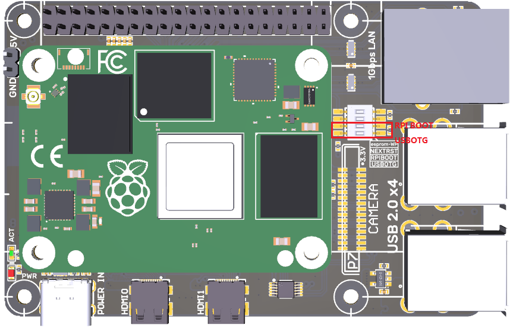
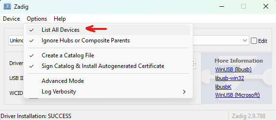
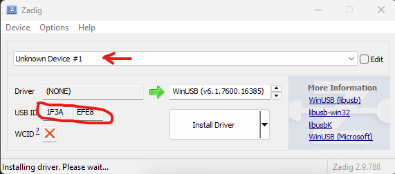

This step-by-step guide explains how to flash Armbian Linux onto the BigTreeTech CB1 eMMC compute module. I describe the process for a Windows machine, but the steps are very similar for Linux users.

The eMMC version of the CB1 has built-in storage, which makes the process slightly more complicated than flashing an SD card for the non-eMMC versions.

## Requirements

You will need the following items to complete the process.

### Hardware

- A BigTreeTech RPI adapter or a BigTreeTech Manta board to provide the necessary USB and LAN connectors.
- A USB-C cable to connect and power the CB1 from your Windows machine. For added reliability, I recommend putting a USB hub with a dedicated power adapter in between.

### Software

- A universal USB driver. See [Zadig](https://zadig.akeo.ie/).
- Allwinner tools to switch the CB1 into USB device mode. See [sunxi-tools](https://github.com/bigtreetech/sunxi-tools) or [the sunxi wiki](https://linux-sunxi.org/FEL/USBBoot#Using_sunxi-fel_on_Windows).
- An Armbian Linux image of your choice. See [Armbian for CB1](https://armbian.com/boards/bigtreetech-cb1).
- An image flashing tool. I used [Balena Etcher](https://etcher.balena.io/).

## Switch the CB1 into eMMC USB storage mode

Set the DIP switches (USB OTG) and (RPI BOOT) to ON to enter BOOT mode.



## Install the universal USB driver

- Connect your CB1 to your Windows machine.
- Install and start Zadig.
  - Download and run [Zadig](https://zadig.akeo.ie/).
- List all USB devices.
  - In Zadig, list all USB devices on your machine.
    
- Identify your CB1.
  - Look for your device, which will likely appear as an unknown device. Try each device until you find the one with the correct USB ID.
    
    - If you cannot find it, make sure that the DIP switches are set correctly and that your USB connection is working properly.
- Install the driver.

## Enable the CB1 eMMC as a USB storage device

- Download the required files.

  - Obtain `sunxi-fel.exe` and `u-boot-sunxi-cb1-emmc.bin` from [sunxi-tools](https://github.com/bigtreetech/sunxi-tools).

- Open a Windows Command Prompt.

  - Press `<WIN>+<R>`, type `cmd`, and press `<ENTER>`.

- Run the sunxi-fel command.

  - Navigate to the folder containing the downloaded sunxi-tools and run the following command:

  ```bat
  sunxi-fel.exe uboot u-boot-sunxi-cb1-emmc.bin
  ```

  - This will switch the CB1 into USB storage mode.

## Flash the Armbian image

- Start [Balena Etcher](https://etcher.balena.io/).
- Select the downloaded Armbian image and flash your CB1 (it should appear as a storage device).
- There is no need to change the default settings. Begin the flashing process.

## Apply the mandatory Armbian configuration

- Modify the `armbianEnv.txt` file.
- Replace the line

  ```ini
  fdtfile=allwinner/sun50i-h616-bigtreetech-cb1-sd.dtb
  ```

  with

  ```ini
  fdtfile=allwinner/sun50i-h616-bigtreetech-cb1-emmc.dtb
  ```

  This change activates the eMMC storage as the boot device. You can revert to the previous setting to boot from an SD card if needed.

## Clean up

- Unmount the eMMC.
  - Safely eject the eMMC storage from your system.
- Disconnect the power.
  - Remove the USB cable or power source.
- Reset the DIP switches.
  - Set the DIP switches (USB OTG) and (RPI BOOT) back to OFF to exit BOOT mode.

## Conclusion

Congratulations! You should now have successfully flashed Armbian onto your BigTreeTech CB1. You can connect the CB1 to a display and keyboard, or to your network, and follow the official Armbian documentation for further setup.

## Further links

- [Armbian BIGTREETECH CB1](https://armbian.com/boards/bigtreetech-cb1)
- [BIGTREETECH sunxi-tools](https://github.com/bigtreetech/sunxi-tools)
- [BIGTREETECH CB1 repository](https://github.com/bigtreetech/CB1)
- [BIGTREETECH CB1 wiki](https://global.bttwiki.com/CB1.html)
- [Sunxi wiki](https://linux-sunxi.org/)


