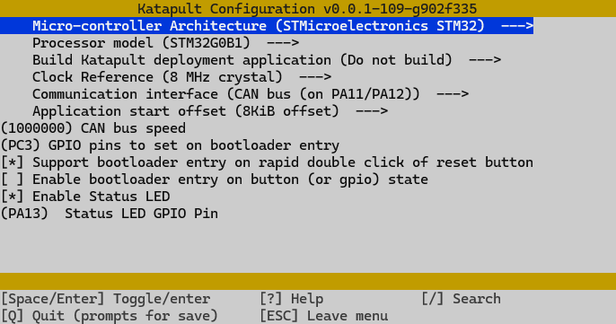
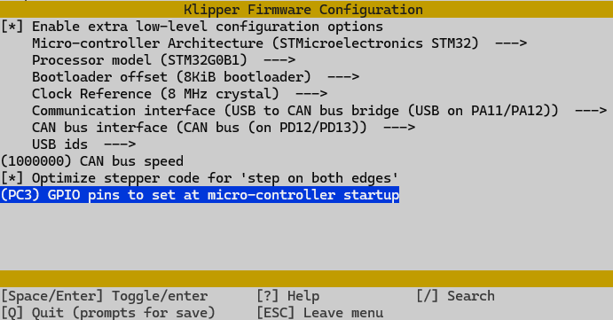
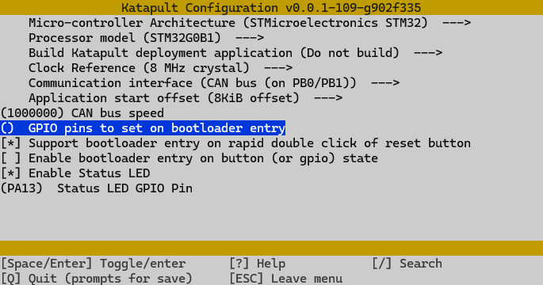
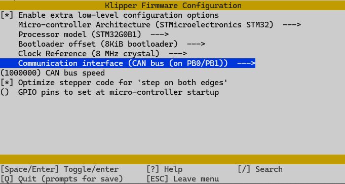
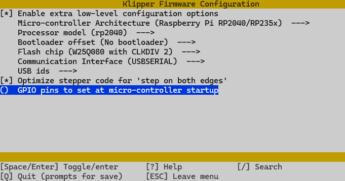
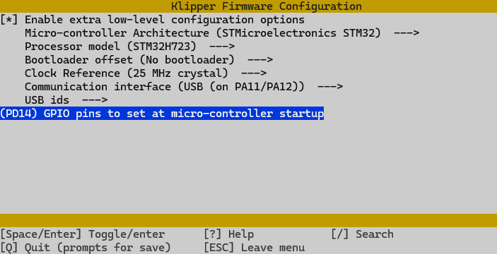

This is a quick and dirty guide, mostly for my own purposes, on how to flash the BTT Manta M8P CAN and the EBB42 board with Klipper using Katapult. The process should work for other BTT Manta M8P and EBB versions too, but you have to adjust the configuration accordingly.

The BTT Manta M8P CAN board can be flashed and used with Klipper via two different methods: a USB connection or CAN bus. If you are using toolhead boards that support CAN bus, like the EBB36 or EBB42, you have to use CAN bus for the communication between the mainboard and the toolhead board. If you are using toolhead boards that support a USB connection (like the BTT SB2209 USB or the EBB36/42 v2.0), use USB instead.

In general, CAN bus is the preferred method for communication between multiple boards in a 3D printer, as it provides better reliability and performance than USB.

I cover two setups below: my Artillery Sidewinder X2 with CAN bus, and my Voron 2.4 with USB.

## Requirements

- A working Klipper installation on a host system (Raspberry Pi, etc.). Follow the [Klipper installation guide](https://www.klipper3d.org/Installation.html) if you haven't done this yet.
- Basic knowledge of using the terminal.
- `dfu-util` installed on your host system. You can install it via your package manager. For example, on Debian/Ubuntu-based systems, you can run:

   ```sh
   sudo apt-get install dfu-util python3-serial
   ```

- A USB cable to connect the BTT Manta M8P board to your host system for flashing Katapult and Klipper.
- A CAN bus connection between the BTT Manta M8P board and the BTT EBB42 board for communication (CAN setup only).

### Configure CAN bus on the host system

There are many ways to set up CAN bus on your host system. I recommend using systemd-networkd for this. Here is a quick example.

Add the following file `/etc/systemd/network/80-can.link`:

```ini
[Match]
Type=can

[Link]
TransmitQueueLength=128
```

Then add the following file `/etc/systemd/network/80-can.network`:

```ini
[Match]
Name=can0

[CAN]
BitRate=1000000
```

Run the following commands to load this configuration:

```sh
sudo systemctl daemon-reload
sudo systemctl restart systemd-networkd
```

## Artillery Sidewinder X2 setup (CAN bus)

- I replaced the original Artillery mainboard with a BTT Manta M8P v1.1 running in CAN mode.
- I replaced the original Artillery toolhead board with a BTT EBB42 v1.2 running in CAN mode.

### Flash the BTT Manta M8P v1.1 in CAN mode

#### Flash Katapult to the Manta M8P

This step is only necessary if you have a brand new BTT Manta M8P board without Katapult installed. If Katapult is already installed, you can skip this step.

1. Download [Katapult](https://github.com/Arksine/katapult).

   ```sh
   cd ~
   git clone https://github.com/Arksine/katapult
   cd katapult   
   ```

2. Configure Katapult for the BTT Manta M8P v1.1 CAN:

   ```sh
   make menuconfig
   ```

   

   Be aware that I have also enabled the PC3 GPIO pin. If you have connected a device like the BTT Relay V1.2 to the PS-ON GPIO pin, the power supply is switched via this pin.

   Save and exit with `Quit` and `Yes`.
3. Build the firmware-bootloader package:

   ```sh
   make -j
   ```

4. Flash Katapult:

   ```sh
   sudo dfu-util -R -a 0 -s 0x08000000:mass-erase:force -D ~/katapult/out/katapult.bin
   ```

5. Reset the board (or power it off and on). Katapult should now be installed, and the status LED will blink.

#### Flash Klipper to the Manta M8P

1. Configure the Klipper firmware for the BTT Manta M8P v1.1 CAN:

   ```sh
   cd ~
   cd klipper
   make menuconfig
   ```

   

   Be aware that I have also enabled the PC3 GPIO pin. If you have connected a device like the BTT Relay V1.2 to the PS-ON GPIO pin, the power supply is switched via this pin.

   Save and exit with `Quit` and `Yes`.
2. Build the Klipper firmware:

   ```sh
   make -j
   ```

3. Stop the Klipper service first:

   ```sh
   sudo service klipper stop
   ```

4. Flash Klipper.
   1. Depending on whether Klipper is already running on the board (update workflow), you need to switch into bootloader mode first. Run the following command to do so:

      ```sh
      ~/klippy-env/bin/python ~/katapult/scripts/flashtool.py -i can0 -u <CANBUS-UUID> -r
      ```

      Replace `<CANBUS-UUID>` with the actual CAN bus UUID of your board (configured in `printer.cfg` in the `[mcu]` section as `canbus_uuid`).
   2. Now you should get something similar to this:

      ```sh
      Canbus Bridge detected at /sys/bus/usb/devices/1-1.4
      Connecting to CAN UUID 4a0cb5640a86 on interface can0
      Sending bootloader jump command...
      Waiting for USB Reconnect...done
      Detected new USB Device: 1d50:6177 katapult stm32g0b1xx
      Katapult detected at serial port /dev/ttyACM0
      Bootloader Request Complete
      ```

      Your board is now in bootloader mode. You can connect to it via the serial port `/dev/ttyACM0`.
   3. Finally, flash the Klipper firmware:

      ```sh
      cd ~/klipper
      make flash FLASH_DEVICE=/dev/ttyACM0
      ```

      This should finish with a `CAN Flash Success` message.
5. Restart Klipper to apply the changes:

   ```sh
   sudo service klipper restart
   ```

### Flash the BTT EBB42 v1.2 in CAN mode

#### Flash Katapult to the EBB42

This step is only necessary if you have a brand new BTT EBB42 board without Katapult installed. If Katapult is already installed, you can skip this step.

1. Connect your EBB42 via USB and prepare it for flashing Katapult.
   1. Power off your printer.
   2. Unplug the CAN bus cable from the EBB42 board to avoid any power issues.
   3. Temporarily bridge the 5V jumper on the EBB42 board to power it via USB.
   4. Put the board into DFU mode by holding the BOOT button while plugging in the USB cable. Alternatively, press and hold the BOOT button, press reset, release reset, and then release BOOT.
   5. The board should now be in DFU mode and ready to be flashed.

2. If needed, download [Katapult](https://github.com/Arksine/katapult).

   ```sh
   cd ~
   git clone https://github.com/Arksine/katapult
   cd katapult   
   ```

3. Configure Katapult for the BTT EBB42 v1.2 CAN:

   ```sh
   cd ~/katapult
   make menuconfig
   ```

   

   Save and exit with `Quit` and `Yes`.
4. Build the firmware-bootloader package:

   ```sh
   make -j
   ```

5. Flash Katapult:

   ```sh
   sudo dfu-util -R -a 0 -s 0x08000000:mass-erase:force -D ~/katapult/out/katapult.bin
   ```

   This should finish with a `File downloaded successfully` message.

6. Remove the 5V jumper, unplug your USB cable, and power off your printer.
   Connect your CAN bus cable to the EBB42 board, then power on. Katapult should now be installed.

#### Flash Klipper to the EBB42

1. Configure the Klipper firmware for the BTT EBB42 v1.2 CAN:

   ```sh
   cd ~
   cd klipper
   make menuconfig
   ```

   

   Save and exit with `Quit` and `Yes`.
2. Build the Klipper firmware:

   ```sh
   make -j
   ```

3. Stop the Klipper service first:

   ```sh
   sudo service klipper stop
   ```

4. Query the CAN bus UUID of the EBB42 board:

   ```sh
   ~/klippy-env/bin/python ~/klipper/scripts/canbus_query.py can0
   ```

   You should get something like this: `Found canbus_uuid=c239709a91c7, Application: CanBoot`

   Make a note of the `canbus_uuid`. It should be the UUID of your EBB42 board, and you need it for the next step.

5. Flash Klipper to the EBB42:

   ```sh
   ~/klippy-env/bin/python3 ~/katapult/scripts/flash_can.py -i can0 -f ~/klipper/out/klipper.bin -u <CANBUS-UUID>
   ```

   Replace `<CANBUS-UUID>` with the actual CAN bus UUID of your board (noted from the last step, or configured in `printer.cfg` in the `[mcu ebb42]` section as `canbus_uuid`).

   This should result in something like this:

   ```sh
   Verifying canbus connection
   Flashing '/home/freaky/klipper/out/klipper.bin'...

   [##################################################]

   Write complete: 21 pages
   Verifying (block count = 649)...

   [##################################################]

   Verification Complete: SHA = 0CD35886C377A91B5AB0E0AD44684CB24DEBE05E
   Programming Complete
   ```

   If you get any errors and you have double-checked your CAN bus UUID, try to reset the EBB42 board by power cycling your printer, and try again. If this does not work, start over with flashing Katapult to the EBB42 board.

6. Restart Klipper to apply the changes:

   ```sh
   sudo service klipper restart
   ```

## Voron 2.4 setup (USB)

- Mainboard: BTT Manta M8P v2.0 (USB mode)
- Toolhead board: BTT EBB SB2209 v1.10 USB

### Flash the BTT EBB SB2209 USB

1. Configure the Klipper firmware for the BTT EBB SB2209 USB:

   ```sh
   cd ~
   cd klipper
   make menuconfig
   ```

   

   Save and exit with `Quit` and `Yes`.
2. Build the Klipper firmware:

   ```sh
   make -j
   ```

3. Stop the Klipper service first:

   ```sh
   sudo service klipper stop
   ```

4. Flash Klipper:

   ```sh
   cd ~/klipper
   make flash FLASH_DEVICE=2e8a:0003
   ```

   This should result in something like this:

   ```sh
   Flashing out/klipper.uf2 to 2e8a:0003
   sudo lib/rp2040_flash/rp2040_flash out/klipper.uf2

   Loaded UF2 image with 166 pages
   Found rp2040 device on USB bus 1 address 9
   Flashing...
   Resetting interface
   Locking
   Exiting XIP mode
   Erasing
   Flashing
   Rebooting device
   ```

5. Restart Klipper to apply the changes:

   ```sh
   sudo service klipper restart
   ```

### Flash the BTT Manta M8P v2.0 in USB mode

1. Configure the Klipper firmware for the BTT Manta M8P v2.0 USB:

   ```sh
   cd ~
   cd klipper
   make menuconfig
   ```

   

   Be aware that I have also enabled the PD14 GPIO pin. If you have connected a device like the BTT Relay V1.2 to the PS-ON GPIO pin, the power supply is switched via this pin.

   Save and exit with `Quit` and `Yes`.
2. Build the Klipper firmware:

   ```sh
   make -j
   ```

3. Stop the Klipper service first:

   ```sh
   sudo service klipper stop
   ```

4. Flash Klipper.

   If you are doing this for the first time, you need to put the board into bootloader mode first. To do so, hold the BOOT button while plugging in the USB cable. Alternatively, press and hold the BOOT button, press reset, release reset, and then release BOOT.

   After that, you can flash the firmware:

   ```sh
   sudo dfu-util -R -a 0 -s 0x08000000:mass-erase:force -D ~/klipper/out/klipper.bin
   ```

   If this results in an error, you probably already have Klipper running on the board.

   In this case, you can use the following command to flash the firmware. The `xxxxxxxxxxx` part of the path may differ in your case, so adjust it accordingly.

   Determine the correct serial path by listing the devices:

   ```sh
   ls /dev/serial/by-id/usb-Klipper_stm32h723xx_*
   ```

   ```sh
   cd ~/klipper
   make flash FLASH_DEVICE=/dev/serial/by-id/usb-Klipper_stm32h723xx_xxxxxxxxxxx-if00
   ```

   This results in something like this:

   ```sh
   Downloading element to address = 0x08000000, size = 41508
   Erase           [=========================] 100%        41508 bytes
   Erase    done.
   Download        [=========================] 100%        41508 bytes
   Download done.
   File downloaded successfully
   ...   
   ```

   Ignore the errors below it, you should be good to go.

5. Restart Klipper to apply the changes:

   ```sh
   sudo service klipper restart
   ```

## Conclusion

After these steps, your mainboard and toolhead board run current Klipper firmware, either over CAN bus with Katapult as the bootloader (Sidewinder X2) or over USB (Voron 2.4).
## Further links

- [Klipper documentation](https://www.klipper3d.org/)
- [Klipper on GitHub](https://github.com/Klipper3d/klipper)
- [Katapult on GitHub](https://github.com/Arksine/katapult)
- [Dr. Klipper wiki: BTT Manta (CAN bridge)](https://drklipper.de/doku.php?id=klipper_faq:flash_guide:stm32h743:btt_manta_m8n_can-bridge)
- [Dr. Klipper wiki: BTT EBB42 (CAN)](https://drklipper.de/doku.php?id=klipper_faq:flash_guide:stm32g0b1:btt_ebb36_ebb42_can)


