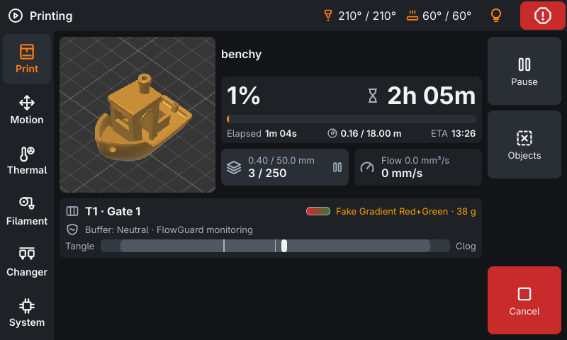
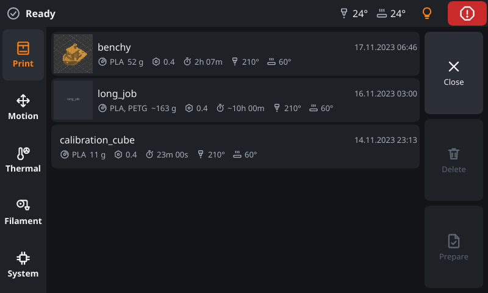
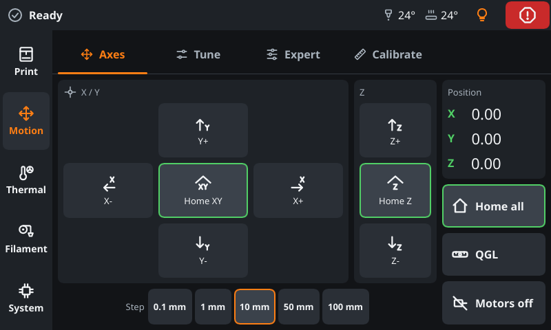
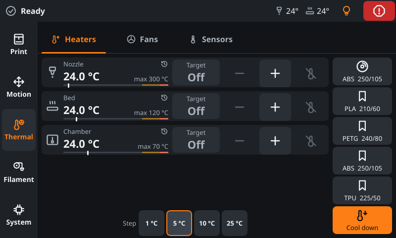
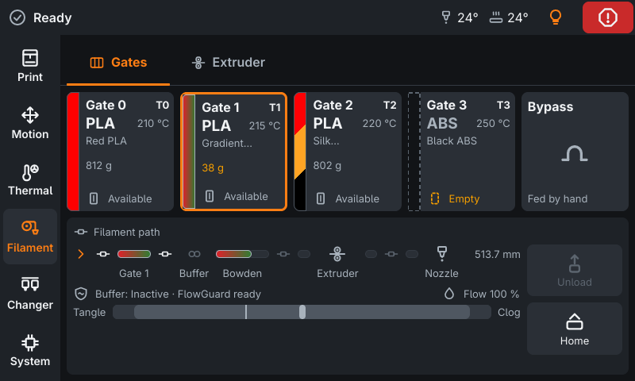
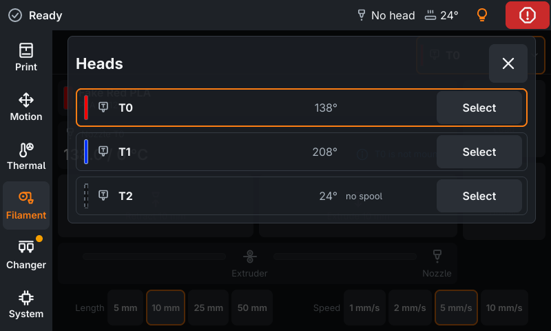
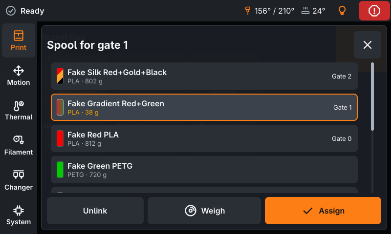

I have been working on a touch screen for my printers for a while now, and it has reached the point where I want you to try it. It is called Sailhand, it is open source, and it is a small native app for the display on your Klipper printer.

I started it because I wanted one screen that handles everyday printing and also knows about the multi-material and tool changer setups I run. Sailhand runs on the printer host (a Raspberry Pi, a BTT CB1/CB2 and similar), starts fullscreen at boot and talks to [Klipper](https://www.klipper3d.org/) through [Moonraker](https://moonraker.readthedocs.io/). It is written in Rust with [Slint](https://slint.dev/), so there is no browser and no desktop environment involved.



> **Caution:** Sailhand is young software. I tested it on a modified Artillery Sidewinder, on my Voron 2.4 with Happy Hare, and on a friend's Voron 2.4 with an ERCF, and it runs great there. Tool changers, AFC and Happy Hare with several units are only tested against a simulated printer, not on real machines. Sailhand moves motors, heats and restarts services, so do not leave your printer unattended while you try it. It comes without any warranty, as far as the law allows (see the GPL).

## What you can use it for

For everyday printing it covers what you would expect from a printer touch screen:

- Browse your files with thumbnails, start, pause and cancel a print, exclude objects and pause at a layer.
- Jog and home the axes, level the bed and run Klipper's calibration commands.
- Control heaters, fans and the light, and watch the temperature history.
- Use the console with your macros, load and unload filament, and handle updates and Wi-Fi.







## What is cool about it

The part I care about most is multi-material and multi-tool support. ERCF, Tradrack, Box Turtle, StealthChanger and more all end up on one Changer page:

- [Happy Hare](https://github.com/moggieuk/Happy-Hare) 4.1 or newer, also with several units.
- [AFC](https://github.com/AFCProject/AFC-Klipper-Add-On) lanes and the lane in use.
- Tool changers through [klipper-toolchanger](https://github.com/viesturz/klipper-toolchanger).
- [Spoolman](https://github.com/Donkie/Spoolman): the spool in use, a spool picker with weighing, and a hint before a print when the file and the filament differ. It never blocks a print, it only tells you.







A few more things I like:

- **It shows only what your printer has.** No Happy Hare, no Happy Hare page. It also points out things that look unusual, without forbidding them.
- **Native and light.** It starts fullscreen at boot via cage, a small Wayland kiosk, and needs no browser.
- **Updates like Mainsail and Fluidd.** New versions show up in Moonraker's update manager.
- **No cloud, no telemetry.** Sailhand only talks to your Moonraker.
- **It runs elsewhere too.** You can use it on an Android phone or tablet as a touch screen near the printer, or as a window on a Linux or Windows desktop.
- **Open source.** It is licensed under GPL-3.0-or-later, and use is free for everyone.

## Requirements

- Klipper with Moonraker, as set up by KIAUH, MainsailOS and similar.
- A host with Debian 12, Raspberry Pi OS Bookworm or Ubuntu 22.04 (or newer). The installer checks the rest.
- A display, ideally 5" at 800x480 with touch. Other sizes are scaled.

## Install

Run this on the printer host, as the user that runs Klipper and Moonraker:

```bash
curl -fsSLO https://github.com/freakydude/sailhand/releases/latest/download/get-sailhand.sh
bash get-sailhand.sh -m http://127.0.0.1:7125
```

The script picks the build for your system, installs the few packages it needs and sets up a service. Sailhand then starts on the display at every boot.

If you do not want to touch your printer host yet, try the desktop window or the Android app first. The GitHub project describes all the ways to install it.

## Try it and tell me

On my machines it runs great, but I cannot do much more alone. I only have a few printers to test on, so I need you: install it, play with it and tell me what works and what does not. This is especially true if you run a tool changer, AFC or several Happy Hare units, since I could only test those against a simulated printer.

- Report bugs and missing features as [GitHub issues](https://github.com/freakydude/sailhand/issues/new/choose).
- Ask questions or show me your printer on [Discord](https://discord.gg/Ja2cxCcmJQ).

It is a private project I work on in my spare time, so answers may take a while. A documentation site is coming later.

## Conclusion

Sailhand is my attempt at a touch screen that fits a printer instead of the other way around. It is ready to try, and I would love to hear how it behaves on your machine. Keep an eye on the printer while you test it, and then let me know what you think.

## Further links

- [Sailhand on GitHub](https://github.com/freakydude/sailhand)
- [Klipper](https://www.klipper3d.org/)
- [Moonraker](https://moonraker.readthedocs.io/)
- [Happy Hare](https://github.com/moggieuk/Happy-Hare)
- [AFC](https://github.com/AFCProject/AFC-Klipper-Add-On)
- [klipper-toolchanger](https://github.com/viesturz/klipper-toolchanger)
- [Spoolman](https://github.com/Donkie/Spoolman)
- [Slint](https://slint.dev/)


